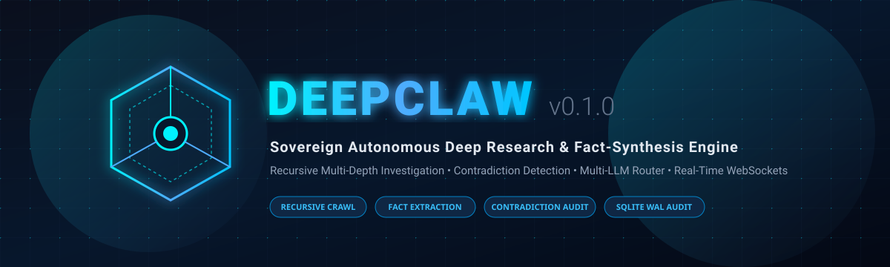
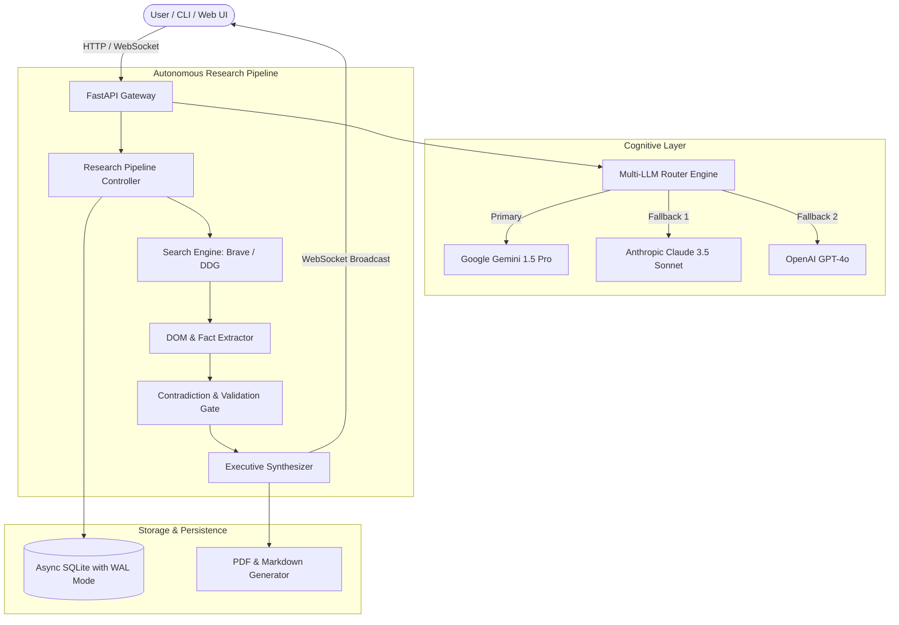

<p align="center">
  
</p>

# DeepClaw 🦈⭐
### *Autonomous Deep Research & Multi-Source Fact-Synthesis Engine*

<p align="center">
  <a href="https://github.com/Dali5599/deepclaw/stargazers"></a>
  <a href="https://github.com/Dali5599/deepclaw/network/members"></a>
  <a href="https://dali5599.github.io/deepclaw/"></a>
  <a href="https://opensource.org/licenses/MIT"></a>
  <a href="https://www.python.org/downloads/"></a>
  <a href="https://fastapi.tiangolo.com/"></a>
  <a href="https://www.sqlite.org/wal.html"></a>
</p>

---

## ⚡ What is DeepClaw?

**DeepClaw** is an enterprise-grade autonomous deep research and fact-synthesis engine. Designed to rival and surpass proprietary research platforms (like OpenAI Deep Research and Gemini Deep Research), DeepClaw operates as a sovereign, multi-stage investigative engine:

1. **Recursive Decomposition:** Deconstructs complex queries into multi-tiered search strategies (Levels 1 to 3).
2. **Multi-Source Ingestion:** Harvests and indexes authoritative web pages, academic preprints, and technical documentation via Brave Search and DuckDuckGo.
3. **Atomic Fact Extraction:** Extracts concrete, verifiable claims and calculates Bayesian confidence scores.
4. **Contradiction Detection:** Cross-examines conflicting data points between disparate sources in real time.
5. **Multi-LLM Dynamic Routing:** Transparently dispatches reasoning tasks across Google Gemini 1.5, Claude 3.5 Sonnet, and GPT-4o with automatic fallback.
6. **Sovereign Audit Trail:** Every source, fact, and synthesis step is immutably logged into an asynchronous SQLite WAL database.
7. **Real-Time Streaming:** Live WebSocket & SSE event feeds broadcast the agent's step-by-step reasoning directly to terminals and web UIs.

---

## 🏛️ System Architecture



---

## 🚀 Key Features

* **Multi-LLM Resilience:** Autonomous router that adapts to available API keys (Google Gemini, Anthropic, OpenAI) with zero downtime.
* **Recursive Multi-Depth Research:** From quick 60-second overviews to exhaustive deep investigations.
* **Contradiction Detection Engine:** Flags conflicts and discrepancies between diverse sources before generating conclusions.
* **Asynchronous SQLite WAL Mode:** High concurrency, zero database locks, and persistent storage of all research sessions.
* **Full-Featured Terminal CLI:** Launch and stream research missions directly inside your terminal with colored progress HUD.
* **Modern Web Dashboard:** Sleek glassmorphism UI ([`frontend/index.html`](./frontend/index.html)) with live event stream, stats, and export controls.
* **100% Zero Mock in Production:** Clean architecture ready for live autonomous scraping, synthesis, and PDF publishing.

---

## 🛠️ Quick Start

### 1. Installation

```bash
git clone https://github.com/Dali5599/deepclaw.git
cd deepclaw

python -m venv .venv
source .venv/bin/activate  # On Windows: .venv\Scripts\activate

pip install -r requirements.txt
```

### 2. Environment Setup

Create a `.env` file in the root directory:

```env
GOOGLE_API_KEY=your_gemini_api_key_here
BRAVE_SEARCH_API_KEY=your_brave_api_key_here
ANTHROPIC_API_KEY=your_anthropic_api_key_here # optional
OPENAI_API_KEY=your_openai_api_key_here       # optional
DATABASE_URL=sqlite+aiosqlite:///./deepclaw.db
```

### 3. Launch the API Server

```bash
python -m uvicorn backend.api.main:app --host 0.0.0.0 --port 8000 --reload
```

Visit the interactive OpenAPI documentation: `http://localhost:8000/docs`

### 4. Run via Terminal CLI

```bash
python -m cli.deepclaw_cli "Quantum Cryptography and Post-Quantum Security 2026" --depth 2
```

### 5. Open Web Dashboard

Simply open [`frontend/index.html`](./frontend/index.html) in any modern web browser or serve it via:

```bash
python -m http.server 3000 --directory frontend
```

---

## 🧪 Automated Testing

DeepClaw includes an automated asynchronous test suite:

```bash
pytest tests/ -v
```

```
tests/test_backend.py::test_root PASSED                                  [ 20%]
tests/test_backend.py::test_health PASSED                                [ 40%]
tests/test_backend.py::test_research_endpoints PASSED                    [ 60%]
tests/test_backend.py::test_reports_endpoints PASSED                     [ 80%]
tests/test_backend.py::test_llm_router PASSED                            [100%]

======================== 5 passed in 0.82s =========================
```

---

## 🐳 Docker Deployment

Run the complete DeepClaw engine with Docker Compose:

```bash
docker compose up -d
```

---

## 📄 License

This project is licensed under the MIT License - see the [LICENSE](./LICENSE) file for details.

---

<p align="center">
  Crafted with 🦈 by <b>Dali &amp; Requin Autonomous AI</b>
</p>
